# LunarEdge — NASA Space Apps Challenge 2026
## Live Pitch Slide Deck (8–10 Minutes)

> **Team:** LunarEdge (4 Members)  
> **Visual Style:** Deep space navy (`#060b16` / `#0d1528`), Electric Cyan (`#38bdf8`), Solar Gold (`#fbbf24`), Slate Gray (`#94a3b8`)  
> **Rule Compliance:** Professional space-tech diagrams, no cartoon graphics, strict scientific integrity, zero unverified numbers.

---

### Slide 1: Title & Identity

```
┌────────────────────────────────────────────────────────────────────────┐
│  [ NASA Space Apps Challenge 2026 · Decision-Support Prototype ]       │
│                                                                        │
│                            LUNAREDGE                                   │
│                 Lunar Landing Site Navigator                           │
│                                                                        │
│            "Compare site + date with honest N/A."                      │
│                                                                        │
│  Team LunarEdge: 4 Engineers · Topocentric Horizons + GSFC LOLA        │
└────────────────────────────────────────────────────────────────────────┘
```

#### Visual Layout:
- Background: Minimalist deep-navy space gradient.
- Typography: Clean sans-serif title in white with bright cyan (`#38bdf8`) glow.
- Tagline: Displayed in solar gold (`#fbbf24`).
- Header tag: Small capsule badge at top: `NASA Space Apps Challenge 2026 · Decision-Support Prototype`.

#### Slide Content:
- **Product:** Lunar Landing Site Navigator
- **Core Mission:** Evaluating lunar south-pole landing site & UTC date trade-offs.
- **Team:** LunarEdge (4 members)

> **Speaker Notes (~30 words):**  
> *"Good morning, judges. We are team LunarEdge. We built the Lunar Landing Site Navigator to solve one of the hardest challenges in Artemis mission planning: evaluating landing sites with honest, uncoerced physics."*

---

### Slide 2: The South Pole Problem

```
┌────────────────────────────────────────────────────────────────────────┐
│  THE SOUTH POLE IS UNFORGIVING                                         │
│                                                                        │
│  [ LOW SUN ELEVATION ]          [ LIBRATING EARTH ]                    │
│  • Moon tilt: only 1.54°        • Wobbles near local horizon           │
│  • Sun skims at 1° to 3°        • Multi-day comms blackouts            │
│  • Permanent crater shadows     • Line-of-sight vanishes rapidly       │
│                                                                        │
│  HYPER-SENSITIVITY: 5 km or 48 hours completely flips power & comms!   │
└────────────────────────────────────────────────────────────────────────┘
```

#### Visual Layout:
- Two comparative cards side-by-side:
  - **Left Card (Sun)**: Accent border in solar gold (`#fbbf24`), grazing angle icon.
  - **Right Card (Earth)**: Accent border in cyan (`#38bdf8`), libration curve icon.
- Bottom alert bar in amber: `Hyper-sensitivity: 5 km or 48 hours completely flips mission viability.`

#### Slide Content:
- **Low-Incidence Solar Lighting:** Lunar rotational tilt is only $1.54^\circ$. The Sun circles the horizon continuously low ($1^\circ$–$3^\circ$), casting elongated, fast-moving topographic shadows.
- **Earth Libration & Blackouts:** Earth wobbles low on the local horizon. Topographic dips cause continuous 50- to 100-hour direct-to-Earth communications blackouts.
- **The Trade Study Dilemma:** Moving a landing site just 5 kilometres or shifting launch by 48 hours turns a continuous sunlight window into freezing darkness.

> **Speaker Notes (~30 words):**  
> *"At the lunar south pole, the Sun skims the horizon at two degrees, and Earth wobbles low. A shift of five kilometers or two days can plunge a lander into weeks of darkness."*

---

### Slide 3: The Solution — LunarEdge

```
┌────────────────────────────────────────────────────────────────────────┐
│  FOUR SCREENS · ONE SOUTH-POLE CLOCK                                   │
│                                                                        │
│  [ 1. SOURCED EPHEMERIS ]        [ 2. UNBIASED TRADE STUDY ]           │
│  • Real JPL Horizons (DE441)     • Multi-scenario comparison           │
│  • Lunar surface: coord@301      • Aligned metrics side-by-side        │
│  • Topocentric apparent Az/El    • Preserves N/A for unknowns          │
│                                                                        │
│  [ 3. DUAL-MODE VISUALS ]        [ 4. DECISION SUPPORT ]               │
│  • 2D Polar Zenith projection    • Not a safety ranker                 │
│  • Interactive 3D Hemisphere     • Honest decision-support tool        │
└────────────────────────────────────────────────────────────────────────┘
```

#### Visual Layout:
- 2x2 modular matrix with cyan borders and clear icon badges.
- Central unifying banner: `Unified ISO-8601 UTC Timebase Across All Views`.

#### Slide Content:
- **Topocentric Ephemeris Engine:** Directly queries NASA/JPL Horizons for the Moon-surface observer (`coord@301`), extracting true topocentric Sun and Earth azimuth/elevation series.
- **Side-by-Side Scenario Compare:** Evaluates 2 or 3 landing sites or launch dates on the exact same mission clock.
- **Dual Visualizations:** Instant switching between high-precision 2D polar zenith charts and an interactive 3D celestial hemisphere.
- **Decision-Support Focus:** Eliminates guesswork without overstepping into certified flight claims.

> **Speaker Notes (~30 words):**  
> *"LunarEdge is a decision-support navigator that synchronizes NASA Horizons ephemerides with GSFC candidate sites on one unified clock. Planners test and compare sites in 2D and 3D with total scientific transparency."*

---

### Slide 4: User Journey Diagram

```mermaid
flowchart LR
    A["1. Overview<br/>(/)"] --> B["2. Candidate Roster<br/>(/sites)"]
    B --> C["3. Site Brief & 3D Terrain<br/>(/sites/[id])"]
    C --> D["4. Mission Control<br/>(/dashboard)"]
    D --> E["5. Scenario Compare<br/>(/compare)"]
    E --> F["6. Sources & Methodology<br/>(/methodology)"]

    style A fill:#0d1528,stroke:#38bdf8,stroke-width:2px,color:#e2e8f0
    style B fill:#0d1528,stroke:#38bdf8,stroke-width:2px,color:#e2e8f0
    style C fill:#0d1528,stroke:#fbbf24,stroke-width:2px,color:#e2e8f0
    style D fill:#0d1528,stroke:#38bdf8,stroke-width:2px,color:#e2e8f0
    style E fill:#0d1528,stroke:#fbbf24,stroke-width:2px,color:#e2e8f0
    style F fill:#0d1528,stroke:#94a3b8,stroke-width:1px,color:#e2e8f0
```



#### Visual Layout:
- High-contrast horizontal flowchart showing seamless, non-siloed navigation across all 6 core routes.
- Highlight on **Mission** (solar analysis) and **Compare** (trade study).

#### Slide Content:
1. **Overview (`/`):** Context, challenge background, and immediate action paths.
2. **Candidate Roster (`/sites`):** Polar stereographic map & curated GSFC regions.
3. **Site Brief (`/sites/[id]`):** 3D topographic terrain relief & verified geodetic coordinates.
4. **Mission Dashboard (`/dashboard`):** Real-time ephemeris query, 2D/3D sky, timeline playback, and CSV export.
5. **Scenario Compare (`/compare`):** Multi-scenario trade matrix with aligned metric curves.
6. **Sources & Methodology (`/methodology`):** Mathematical formulas, Horizons quantity codes, and LOLA CRS references.

> **Speaker Notes (~30 words):**  
> *"Our user journey flows logically: pick a candidate site, inspect its 3D topography, run an ephemeris window, compare alternative dates, and review the verified NASA source contracts."*

---

### Slide 5: Candidate Sites — NASA/GSFC Product 78

```
┌────────────────────────────────────────────────────────────────────────┐
│  SIX CURATED REGIONS · NO INVENTED LANDING SPOTS                       │
│                                                                        │
│  VERIFIED (GSFC Shapefiles):     UNVERIFIED (Coordinates Pending):     │
│  • Site 01: Connecting ridge     • Site 20: Leibnitz beta plateau      │
│    (-89.4389°, 222.9040° E)        (lat=null, lon=null → N/A)          │
│  • Site 04: Shackleton rim       • Site 23: Malapert massif            │
│    (-89.7623°, 202.9366° E)        (lat=null, lon=null → N/A)          │
│  • Site 07: Peak near Shackleton                                       │
│    (-88.8076°, 123.7033° E)      5 m/px LOLA DEM:                      │
│  • Site 11: de Gerlache rim      • Regional tiles documented           │
│    (-88.6858°, 291.5211° E)      • Polar Stereographic CRS             │
└────────────────────────────────────────────────────────────────────────┘
```

#### Visual Layout:
- Left: Verified sites list in cyan with checkmarks.
- Right: Unverified sites list with amber caution badges (`Coordinates pending verification`).
- Bottom callout: `GSFC Product 78 (Mazarico et al., 2011) — Regional 5 m/px LOLA DEMs`.

#### Slide Content:
- **Strict Catalogue Sourcing:** Grounded exclusively in documented NASA Goddard Space Flight Center (GSFC) candidate landing regions.
- **Verified Coordinates:** 4 regions have coordinates validated against GSFC shapefile boundaries.
- **Unverified Handling:** Sites 20 and 23 retain explicit `null` coordinates and trigger UI warnings, preventing accidental queries on fictitious coordinates.

> **Speaker Notes (~30 words):**  
> *"We do not invent landing coordinates. We use six official GSFC Product 78 regions. Four have verified coordinates; two remain unverified and safely display N/A to protect mission accuracy."*

---

### Slide 6: Mission Dashboard — Local Sky & Timeline

```
┌────────────────────────────────────────────────────────────────────────┐
│  MISSION DASHBOARD · LOCAL CELESTIAL HORIZON                           │
│                                                                        │
│  [ 2D POLAR ZENITH PLOT ]        [ 3D CELESTIAL HEMISPHERE ]           │
│  • 0° to 90° concentric rings    • Interactive orbit / pitch / zoom    │
│  • Azimuth 0° = North, clockwise • 3D Artemis Lander with solar wings  │
│  • Sun (Gold) & Earth (Cyan)     • Dynamic ground shadow opposite Sun  │
│  • Past orbital motion trails    • Telemetry beam & blackout warning   │
│                                                                        │
│  SCRUBBABLE TIMELINE: Sample step (5–60 min) · Time to Sunset/Earthset │
└────────────────────────────────────────────────────────────────────────┘
```

#### Visual Layout:
- Visual split screen:
  - Left: 2D polar plot diagram showing concentric rings and azimuth ticks.
  - Right: 3D hemisphere wireframe dome with lander, shadow, and comms beam.
- Bottom timeline scrub bar with `Play / Pause` and countdown metrics.

#### Slide Content:
- **Dual Visual Modalities:**
  - **2D Polar Plot:** Quantitative instrument view showing topocentric zenith elevation and azimuth angles.
  - **3D Celestial Hemisphere:** Contextual spatial view featuring the 3D Artemis lander, real-time dynamic shadows, pulsing solar corona, and line-of-sight comms beam.
- **Dynamic Operational Windows:** Real-time countdowns to next sunset and next Earthset.
- **Timeline Scrubbing:** 1 to 336 hours of ephemeris data at 5- to 60-minute resolution.

> **Speaker Notes (~30 words):**  
> *"On the mission dashboard, planners inspect the sky in 2D or 3D. The 3D dome renders the Artemis lander, real-time shadows, and an animated telemetry beam that warns during Earth blackout."*

---

### Slide 7: Multi-Scenario Compare — The Trade Study

```
┌────────────────────────────────────────────────────────────────────────┐
│  MULTI-SCENARIO TRADE STUDY · SAME CLOCK                               │
│                                                                        │
│  METRIC                          CONNECTING RIDGE     SHACKLETON RIM   │
│  ────────────────────────────────────────────────────────────────────  │
│  Sunlight Duration (hours)       25.0 h               25.0 h           │
│  Earth Visibility (hours)        0.0 h (Blackout)     0.0 h (Blackout) │
│  Longest Earth Blackout          25.0 h               25.0 h           │
│  Mean Solar Elevation            +1.47°               +1.15°           │
│  Relative Solar Incidence        0.026                0.019            │
│  Terrain Slope Mean              N/A                  N/A              │
│                                                                        │
│  HONEST ALIGNMENT: Missing slope stays N/A — never coerced to zero!    │
└────────────────────────────────────────────────────────────────────────┘
```

#### Visual Layout:
- Clean, high-contrast dark data table with cyan headers and gold highlights.
- Clear `N/A` badges in slate gray for uncomputed metrics.

#### Slide Content:
- **Concurrent Trade Evaluation:** Evaluates 2 or 3 landing scenarios simultaneously using parallel backend execution.
- **Side-by-Side Metric Alignment:** Direct comparison of sunlight hours, Earth visibility, blackout duration, mean solar elevation, and horizontal solar incidence.
- **Zero-Coercion Guarantee:** Missing metrics remain `null` / `N/A`. The engine never averages nulls or treats unverified terrain slopes as $0^\circ$.

> **Speaker Notes (~30 words):**  
> *"Our comparison tool runs scenarios in parallel. Here, Connecting Ridge gives 35% higher solar incidence than Shackleton Rim. Uncomputed terrain slopes remain honest N/A—never corrupted into false zeros."*

---

### Slide 8: Data Sources & Authority Boundaries

```
┌────────────────────────────────────────────────────────────────────────┐
│  AUTHORITATIVE NASA DATA FLOW                                          │
│                                                                        │
│  [ NASA / JPL HORIZONS ]            [ NASA / GSFC LOLA ]               │
│  • Ephemeris: DE441                 • Product 78 Regional Tiles        │
│  • Observer: coord@301              • Resolution: 5 m/pixel            │
│  • Quantities: 4 (Azimuth/Elev)     • South Polar Stereographic CRS    │
│  • Timescale: UTC with trailing Z   • Reference: Mazarico et al. 2011  │
│                                                                        │
│  REFERENCE ONLY: NASA Moon Trek & QuickMap (no raster scraping)        │
└────────────────────────────────────────────────────────────────────────┘
```

#### Visual Layout:
- Two authoritative source pillars with official NASA data badges.
- Separation bar at bottom clearly marking external browser tools as reference-only.

#### Slide Content:
- **NASA/JPL Horizons API:**
  - Ephemeris model: DE441 lunar numerical integration.
  - Observer origin: `coord@301` topocentric lunar surface geodetic frame.
  - Quantities: Code 4 (Apparent Azimuth and Elevation vs local topocentric horizontal plane).
- **NASA/GSFC LOLA Product 78:**
  - High-resolution 5 m/pixel digital elevation models (DEMs).
  - Lunar South Polar Stereographic projection ($R = 1,737,400\text{ m}$, latitude of true scale $-90^\circ$, `MOON_ME_DE421`).
- **Boundary Preservation:** No raster GeoTIFFs committed to git; no unauthorized web scraping.

> **Speaker Notes (~30 words):**  
> *"We source directly from two NASA pillars: JPL Horizons DE441 for topocentric Sun and Earth angles, and GSFC Product 78 for LOLA 5-meter terrain models. Boundaries are clean and authenticated."*

---

### Slide 9: Non-Negotiables & Scientific Integrity

> [!IMPORTANT]
> **MANDATORY SCIENTIFIC INTEGRITY DECLARATION**

```
┌────────────────────────────────────────────────────────────────────────┐
│  NON-NEGOTIABLE SCIENTIFIC BOUNDARIES                                  │
│                                                                        │
│  1. NASA DOES NOT ENDORSE LUNAREDGE                                    │
│     Decision-support prototype only. Not certified for flight,         │
│     landing safety, or communications operations.                      │
│                                                                        │
│  2. N/A MEANS UNKNOWN — NEVER SUBSTITUTE ZERO                          │
│     In lunar physics, 0° is a valid elevation angle (the horizon).     │
│     Coercing null to 0 destroys mission safety calculations.           │
│                                                                        │
│  3. GEOMETRIC HORIZON ONLY — NOT WATTS, NOT A LINK BUDGET              │
│     Solar incidence is dimensionless max(0, sin(el)).                  │
│     Earth line-of-sight is geometric center, not a comms link budget.  │
│                                                                        │
│  4. SIX GSFC PRODUCT 78 SITES ONLY                                     │
│     Strictly curated regions. No invented landing coordinates.         │
│     Labelled DEMO fixture for offline fallback; never mix mock data.   │
└────────────────────────────────────────────────────────────────────────┘
```

#### Visual Layout:
- High-visibility safety card with warning borders and distinct numbered items.
- Bold disclaimer headers with concise explanatory text.

#### Slide Content:
- **Not NASA Endorsed:** Clear institutional disclaimer that this is a Space Apps prototype.
- **Null Safety:** Preserving `null` as unknown across APIs, databases, calculations, and UI displays.
- **Physical Demarcation:** Distinguishing smooth-sphere geometric visibility from terrain obstruction; distinguishing solar geometry from electrical power sizing; distinguishing line-of-sight from RF comms link budgets.
- **Data Authenticity:** Labelled `demo_mock` quality indicators whenever offline fixtures are used.

> **Speaker Notes (~30 words):**  
> *"Our non-negotiables are strict: NASA does not endorse LunarEdge. N/A is never zero. Geometric line-of-sight is not an electrical or comms budget. And we never invent landing spots."*

---

### Slide 10: Technical Architecture

```
┌────────────────────────────────────────────────────────────────────────┐
│  FULL-STACK ARCHITECTURE                                               │
│                                                                        │
│  [ FRONTEND — Next.js 16 ]           [ BACKEND — FastAPI & Python ]    │
│  • App Router (React 19)             • Python 3.12, FastAPI, Pydantic  │
│  • High-DPI 3D Canvas Projection     • ThreadPoolExecutor Concurrency  │
│  • In-Memory Client Deduplication    • Deterministic Disk Cache        │
│  • Sub-millisecond route transitions • Streaming RFC-4180 CSV Export   │
│                                                                        │
│  ROBUSTNESS & VERIFICATION:                                            │
│  • 29 Pytest unit tests (0.20s)      • Ruff linter: 0 errors           │
│  • Semgrep Security Audit: 0 findings across 1,235 rules               │
└────────────────────────────────────────────────────────────────────────┘
```

#### Visual Layout:
- Two vertical tech stack pillars (Next.js vs FastAPI) connected by typed REST API contracts.
- Quality assurance verification badges at the bottom.

#### Slide Content:
- **Frontend Stack:** Next.js 16.4.6, React 19, Tailwind CSS, Recharts 3.2.1, custom 3D Canvas vector projection engine with zero npm dependency bloat.
- **Backend Stack:** FastAPI, Pydantic v2 schemas, `httpx` async client with bounded retries and exponential backoff, concurrent parallel query dispatch.
- **Data Persistence:** UUID-indexed session caching and streaming `text/csv; charset=utf-8` export.
- **Verification:** 29 automated tests, Ruff clean, and 0 Semgrep vulnerabilities across 1,235 rules.

> **Speaker Notes (~30 words):**  
> *"Our stack pairs Next.js 16 with a high-concurrency FastAPI engine. We achieved zero-bundle bloat 3D canvas rendering, full offline disk caching, and zero security findings across 1,200 rules."*

---

### Slide 11: Live Demo Steps

```
┌────────────────────────────────────────────────────────────────────────┐
│  LIVE DEMO SCRIPT (3 MINUTES)                                          │
│                                                                        │
│  STEP 1: BROWSE CANDIDATES (/sites)                                    │
│  • Polar stereographic roster → Select Connecting Ridge                │
│  • Inspect 3D Topographic Terrain Relief & designated landing ellipse  │
│                                                                        │
│  STEP 2: RUN MISSION ANALYSIS (/dashboard)                             │
│  • Set 24h UTC window → Execute live Horizons query (< 1s)             │
│  • Inspect 2D Polar Sky & switch to 3D Celestial Hemisphere            │
│  • Play timeline: watch Sun shadow rotate & Earth comms beam stream    │
│                                                                        │
│  STEP 3: TRADE STUDY & CSV EXPORT (/compare)                           │
│  • Compare Connecting Ridge vs Shackleton Rim concurrently             │
│  • Download verified CSV spreadsheet for external mission tools        │
└────────────────────────────────────────────────────────────────────────┘
```

#### Visual Layout:
- Numbered action timeline cards with direct UI instructions and expected visual outcomes.

#### Slide Content:
1. **Explore Candidate Sites (`/sites` & `/sites/[id]`):** Demonstrate the curated GSFC roster and the interactive 3D terrain model with the Artemis lander.
2. **Execute Mission Ephemeris (`/dashboard`):** Query JPL Horizons in real-time. Switch from 2D polar plot to 3D hemisphere, show dynamic lander shadows and telemetry beams, and scrub the timeline.
3. **Multi-Scenario Comparison & Export (`/compare`):** Run a side-by-side trade study and download the raw CSV ephemeris series.

> **Speaker Notes (~30 words):**  
> *"In our live demo, we select Connecting Ridge, view its 3D terrain, query Horizons ephemeris in under a second, animate the 3D sky, compare scenarios, and export the CSV dataset."*

---

### Slide 12: Team Roles & Roadmap

```
┌────────────────────────────────────────────────────────────────────────┐
│  TEAM LUNAREDGE & FUTURE ROADMAP                                       │
│                                                                        │
│  MEMBER 1: Systems Architect · Shared API Contracts & Schemas          │
│  MEMBER 2: Frontend Lead · Next.js App Router & UX Workflows           │
│  MEMBER 3: 3D Visualization · Celestial Hemisphere & Terrain Viewer   │
│  MEMBER 4: Scientific Backend · Horizons Ephemeris & Solar Engine      │
│                                                                        │
│  FUTURE ROADMAP:                                                       │
│  • Phase 1 (Completed): Topocentric ephemeris, 3D dome, compare, CSV   │
│  • Phase 2 (Next): LOLA South Polar Stereographic DEM raymarching      │
│  • Phase 3 (Future): Thermal equilibrium & rover traverse slope checks │
└────────────────────────────────────────────────────────────────────────┘
```

#### Visual Layout:
- Team roster grid on left with clear individual ownership boundaries.
- Milestone roadmap progression on right.

#### Slide Content:
- **Team Specialization:**
  - **Member 1:** Architecture, shared contracts, and error handling envelopes.
  - **Member 2:** Next.js App Router pages, responsive design, and accessible inputs.
  - **Member 3:** 3D Canvas hemisphere, vector projections, and terrain relief models.
  - **Member 4:** JPL Horizons client, ephemeris parser, and solar metrics engine.
- **Roadmap:** Transitioning from geometric topocentric visibility to full local DEM tile raymarching once the south-polar stereographic CRS transform is formally validated.

> **Speaker Notes (~30 words):**  
> *"Our four-person team divided contracts, UI, 3D visualization, and science. Phase one delivered full Horizons ephemerides and 3D simulation; phase two will activate raymarched LOLA terrain occlusion."*

---

### Slide 13: Closing & Q&A

```
┌────────────────────────────────────────────────────────────────────────┐
│                                                                        │
│                            LUNAREDGE                                   │
│                                                                        │
│                 "Four screens. One clock. N/A ≠ 0."                    │
│                                                                        │
│            Decision support backed by genuine NASA physics.            │
│                                                                        │
│                      THANK YOU · QUESTIONS & ANSWERS                   │
│                                                                        │
│  Repo: github.com/nasa-challenge-org/nasa-project                      │
│  Live App: localhost:3000 · API Docs: /docs/openapi.md                 │
└────────────────────────────────────────────────────────────────────────┘
```

#### Visual Layout:
- Bold, memorable closing slide with the project motto centered in luminous cyan and gold.
- Links to GitHub repo and OpenAPI documentation at the bottom.

#### Slide Content:
- **Core Summary:**
  - *Four screens. One clock. N/A ≠ 0.*
  - Transparent lunar decision support.
  - Grounded in real NASA/JPL Horizons and NASA/GSFC LOLA data.
- **Invitation to Q&A:** Open floor for technical and scientific questions from judges.

> **Speaker Notes (~30 words):**  
> *"Four screens. One clock. N/A never equals zero. LunarEdge provides honest, physics-grounded decision support for lunar exploration. Thank you, judges. We are happy to answer your questions."*

---

## Slide Deck Quick Reference Summary Table

| Slide # | Slide Title | Core Message | Primary Visual Element | Time |
| :---: | :--- | :--- | :--- | :---: |
| **1** | Title & Identity | Lunar Landing Site Navigator: compare site + date with honest N/A | Dark space navy title card with cyan & gold accents | 0:30 |
| **2** | The South Pole Problem | Low Sun ($1^\circ$–$3^\circ$), Earth libration, high sensitivity to km and hours | Grazing Sun angle and Earth libration comparison cards | 0:45 |
| **3** | The Solution: LunarEdge | Topocentric Horizons ephemeris on a unified south-pole clock | 4-quadrant architecture overview card | 0:45 |
| **4** | User Journey | Six interconnected routes from Overview to Compare and Sources | Mermaid flowchart showing navigation paths | 0:45 |
| **5** | Candidate Sites | Sourced exclusively from GSFC Product 78; unverified sites stay null | Curated sites table with verified coordinates & DEM tags | 0:45 |
| **6** | Mission Dashboard | Dual 2D Polar Zenith Plot & 3D Celestial Hemisphere Dome | Side-by-side 2D plot vs 3D dome with lander & comms beam | 1:00 |
| **7** | Scenario Compare | Multi-scenario trade study aligning metrics without zero-coercion | Side-by-side comparative metric matrix table | 1:00 |
| **8** | Data Sources | Direct JPL Horizons DE441 + GSFC LOLA 5 m/px DEM regional tiles | Authoritative NASA source pillars and boundary limits | 0:45 |
| **9** | Non-Negotiables | NASA does not endorse; N/A ≠ 0; geometric horizon only; no fake sites | High-priority safety declaration callout box | 1:00 |
| **10** | Technical Stack | Next.js 16, concurrent FastAPI, disk caching, CSV export, 0 vulnerabilities | Full-stack architecture diagram & test verification badges | 0:45 |
| **11** | Live Demo Steps | 3-step live demo: Candidates → Mission Run → Scenario Compare | Step-by-step numbered live walkthrough action list | 1:30 |
| **12** | Team & Roadmap | 4 specialized team roles + upcoming LOLA raymarching roadmap | Team responsibility matrix and milestone roadmap | 0:45 |
| **13** | Closing & Q&A | "Four screens. One clock. N/A ≠ 0." Thank you & Q&A | Clean minimalist closing card with repo & API links | 0:30 |
| **Total** | | | | **~9:30** |
